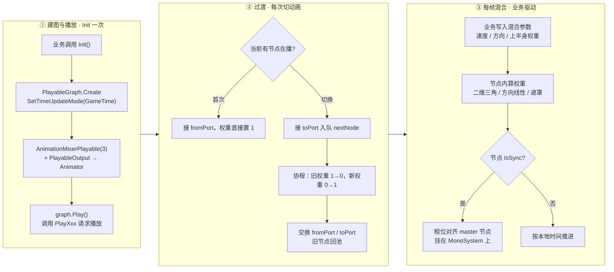
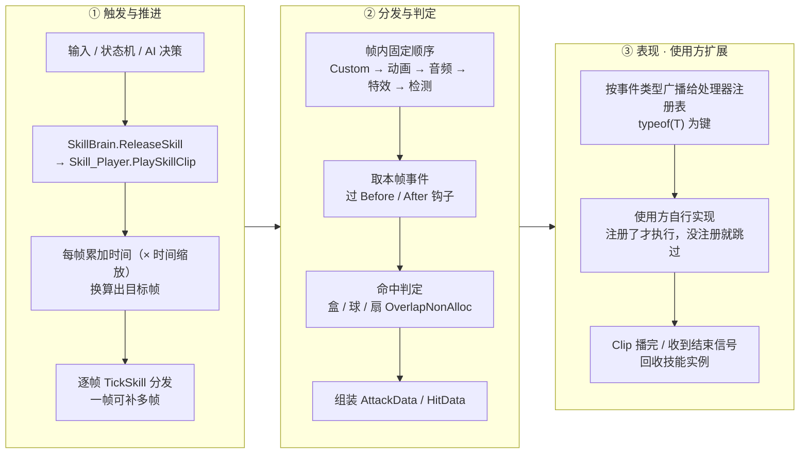
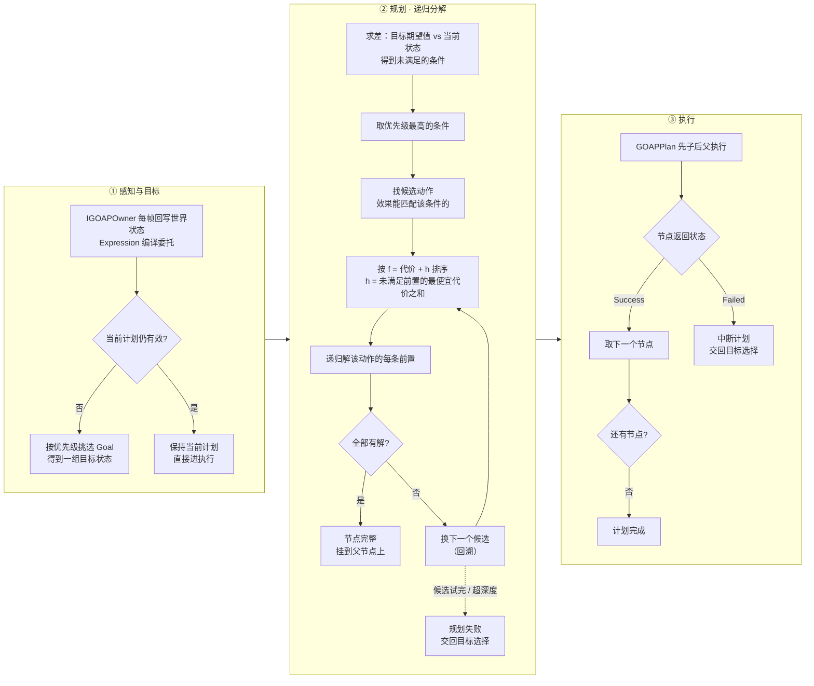
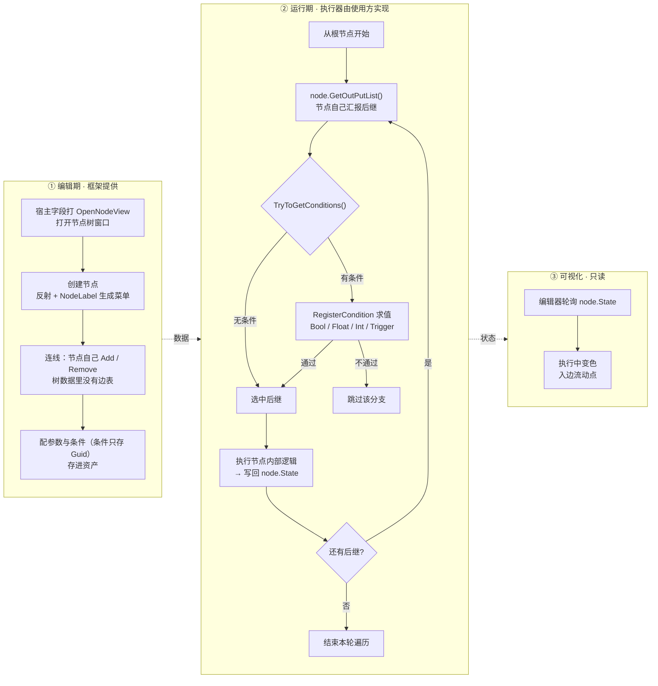
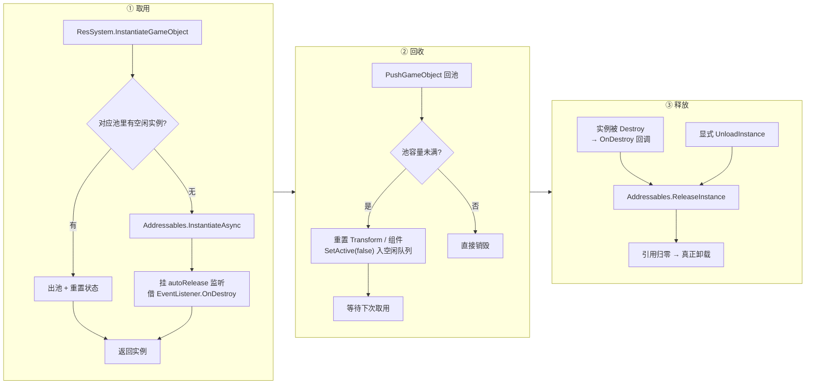
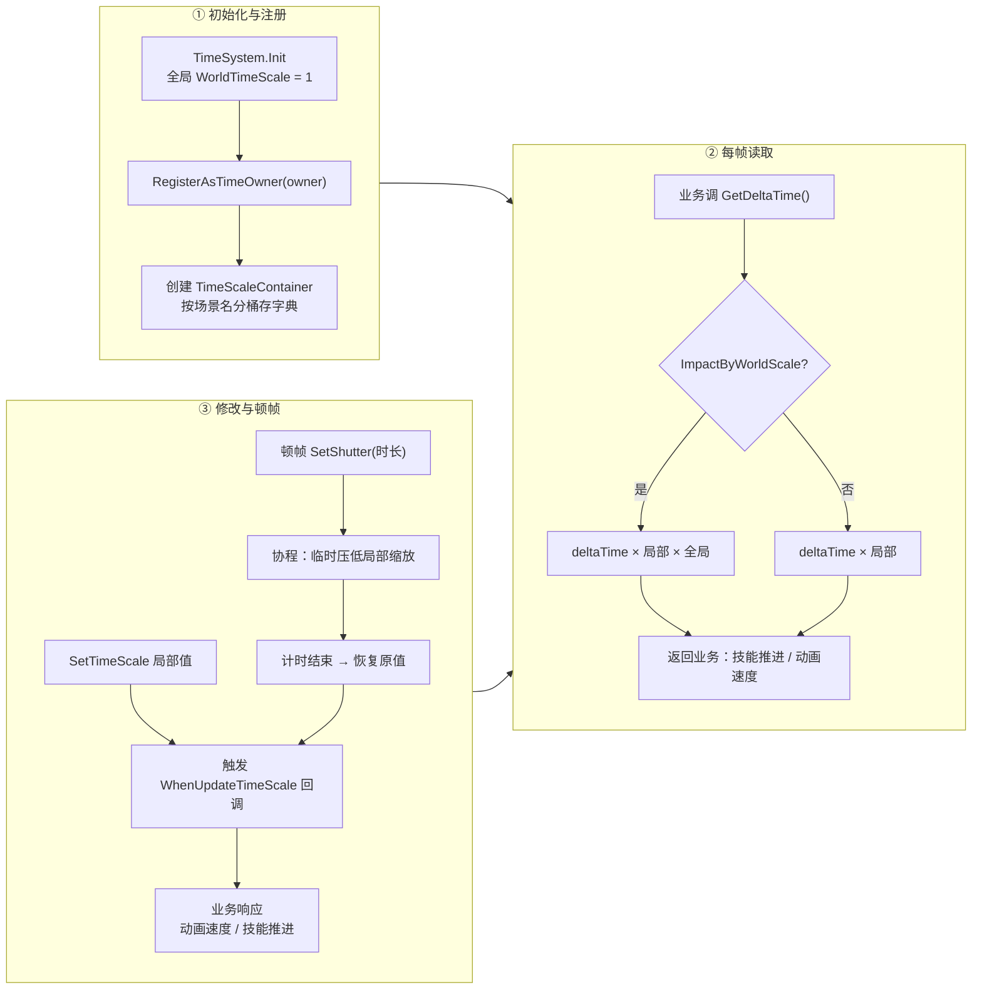
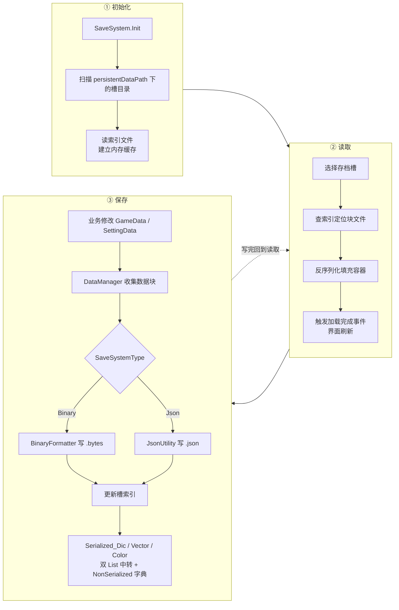
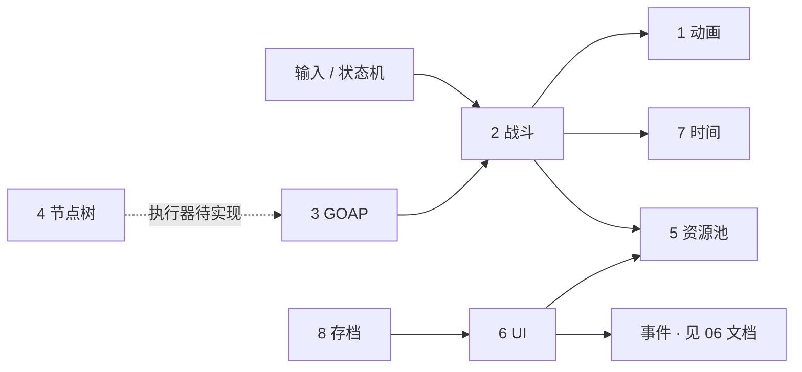

# 09 主要系统工作流程图

> 8 个核心系统的工作流总览。Mermaid 源码可在 GitHub / VS Code / Typora / Obsidian 直接渲染。
> 同目录 `流程图\` 下每张图都有两种格式：`.svg`（矢量，可缩放）与 `.png`（2 倍图，可直接拖进 PPT / Word）。
>
> 重新生成：`node scripts/render-flow.mjs`（改了本文的图之后跑一次即可）
>
> **读图约定**
> - **横向为阶段推进**，每个方框是一栏阶段，栏内自上而下是该阶段的具体步骤
> - 虚线箭头 / 虚线框 = 由**业务方扩展**的部分，框架只负责把数据递到门口
> - 标 `未落地` = 代码中确认尚未实现
>
> **关于战斗事件**：帧事件的表现（伤害、取消、位移、顿帧……）全部由使用方注册处理器实现，图里只画"事件怎么被分发出去"，不涉及具体效果。

---

## 1. 动画系统

**用 PlayableGraph 手搭混合树，主混合器两个端口做过渡，业务每帧只写"混合参数"。**

**读图要点**

1. 建图只做一次，之后所有动画切换都只是"往两个端口里换子图"。
2. 首次播放**不做过渡**（直接占 `fromPort`），避免开场淡入。
3. 每个节点自己建 clip/mixer playable，只对外暴露"接哪根线"，新增一种混合方式不用改控制器。
4. 相位同步跑在 `MonoSystem` 的全局 update 上，不是控制器自己的 `Update`。

---

## 2. 战斗与技能系统

**Clip 记录"第几帧发生什么"，播放器按帧推进并分发事件，具体表现由使用方注册的处理器决定。**

**读图要点**

1. **没有"前摇/判定/后摇"这类阶段枚举**——阶段完全由帧位置 + 轨道事件表达，时间轴只有"帧"这一条。
2. 一次 `Update` 可推进多个逻辑帧（时间缩放或掉帧时代偿），这是抗卡顿的关键。
3. 帧内分发顺序固定，`Before/After` 钩子让行为节点能在中途拦截事件，框架不干预。
4. **③ 整栏都是使用方扩展点**：处理器按 `typeof(T)` 注册，放什么效果、要不要取消全由业务决定。

---

## 3. GOAP 系统

**每帧感知世界状态 → 选目标 → 规划出动作序列 → 逐节点执行，失败就重规划。**

> **关于规划算法**：② 不是 A\*，而且是**刻意不做** A\*。
> GOAP 的计划结构是 **AND/OR 树**——一个动作要求它**所有**前置同时成立（AND），而每个前置只需要**任意一个**动作满足（OR）。A\* 适用于"每个节点只选一个后继"的普通图；硬套的话必须把 AND/OR 展平成世界状态图（节点 = 状态快照、边 = 动作），代价是状态拷贝与哈希，收益是"总代价最优"。
> 而计划寿命极短（世界每帧在变）、决策高频（要一帧内出结果）、行为还要可解释——这个"最优"对游戏没有实际价值。
> 所以实做是：**回归分解 + 启发式排序（f = 代价 + h）+ 失败回溯 + 深度限制**。保留 A\* 的启发式思想，丢掉全局 open/closed 集与最优性保证。

**读图要点**

1. 框架里**没有感知层**——世界状态由 `IGOAPOwner` 每帧从真实对象读出来写回，这是"不侵入业务"的代价。
2. 目标选择是"按优先级取第一个可满足的"，不是多目标联合优化。
3. 执行失败直接丢弃整个计划重规划，所以动作的 `CheckForEffect` 要写得保守。

---

## 4. 节点树系统

**树只描述图，节点自己描述怎么跑；框架提供编辑期建模 + 条件求值 + 可视化，执行器留给使用方。**

**读图要点**

1. **解耦的四条证据**：树数据只有 `List<INodeViewer>`、边由节点自己维护、类型靠特性 + 反射发现、`NodeState` 框架内只读不写。
2. 所以 ② 这一栏是"空心"的——框架不知道谁来走这棵树，也从不给 `State` 赋值。
3. `Trigger` 类条件是"读一次即消费"，适合做"本帧触发一次"的事件节点。
4. ⚠ 现状：全工程没有 `INodeViewer` 的具体实现，Demo 也未使用，**运行时执行器尚未落地**。

---

## 5. 资源管理与对象池

**Addressables 负责真正的加载与释放，两套对象池负责复用，实例销毁即自动释放。**

**读图要点**

1. `autoRelease` 最巧：业务方不需要持有 handle，实例被销毁时自动 `ReleaseInstance`。
2. 两套池分工清楚：普通 `class` 池（数据/行为对象）与 GameObject 池（预制体实例），都用字符串 key 索引。
3. "先查池、池空才走 Addressables"，高频生成的对象几乎没有加载开销。
4. ⚠ 同一实例同时存在"自动释放"与"显式释放"两条路径，重复释放需要留意。

---

## 6. UI 系统

**一个特性声明窗口的全部信息，反射建表，按层挂载，关闭时按缓存策略决定隐藏还是释放。**

```mermaid
flowchart LR
  subgraph P1["① 注册与初始化"]
    direction TB
    G1["窗口类打 UIWindowData<br/>key / layer / assetPath / cache / preInit"] --> G2["FrameUtility 反射扫描全程序集"]
    G2 --> G3["写入 MyFrameSetting.WindowDataDic"]
    G3 --> G4["UISystem.Init：取子节点 UILayout<br/>下标即层级号"]
    G4 --> G5["ifPreInit 的窗口提前实例化并隐藏"]
  end

  subgraph P2["② 打开"]
    direction TB
    O1["ShowWindow(key)"] --> O2{"表里有该 key?"}
    O2 -- 否 --> O3["抛异常中止"]
    O2 -- 是 --> O4{"缓存已实例化?"}
    O4 -- 是 --> O5["SetActive(true) 并置顶"]
    O4 -- 否 --> O6["按 layer 取 Layout<br/>实例化到该层并登记缓存"]
    O6 --> O5
    O5 --> O7["UILayout 调整遮罩层级<br/>挡住下层、不挡新窗口"]
  end

  subgraph P3["③ 关闭"]
    direction TB
    C1["CloseWindow(key)"] --> C2{"ifCache?"}
    C2 -- 是 --> C3["仅隐藏，保留实例"]
    C2 -- 否 --> C4["UnloadInstance 释放<br/>并移除缓存"]
  end

  P1 --> P2 --> P3
```

**读图要点**

1. "特性即注册表"：新增窗口只要写类 + 打特性，不需要维护任何配置表。
2. 层级不是多个 Canvas，而是同一个 Canvas 下按 `UILayout` 下标，遮罩靠调 `sibling index`。
3. `ifCache` 与 `ifPreInit` 是两个正交开关，能表达"常驻后台 / 启动预建 / 用完即毁"。
4. ⚠ 运行时不会重新扫描特性，窗口表来自 setting 资产里已序列化的字典——新增窗口后必须在编辑器保存一次资产。

---

## 7. 时间系统

**世界 × 局部两级缩放容器，每个对象一个"时间旋钮"，顿帧就是临时把旋钮拧小。**

**读图要点**

1. **不是多套独立时钟**，而是"局部 × 全局"两级相乘；全局只有一个 `WorldTimeScale`。
2. 技能时间轴推进用的就是宿主的 `GetDeltaTime()`，所以顿帧、子弹时间不需要改任何业务代码。
3. 回调是"推"的模式：改缩放后由容器通知业务，业务自己决定哪些表现跟着变。
4. ⚠ 重复注册同一个 owner 会让容器与字典错位，注册接口目前没有防重。

---

## 8. 存档系统

**"槽目录 + 数据块文件"的模型，二进制 / JSON 双通道，容器装饰器抹平两套序列化器的差异。**

**读图要点**

1. 玩家存档（`GameDataContainer`）与全局设置（`SettingDataContainer`）分开存放，互不影响。
2. 双通道由 `MyFrameSetting.SaveSystemType` 一个开关切换，默认二进制。
3. `Serialized_Dic` 是这套设计的关键：同时实现 `ISerializationCallbackReceiver` 与 `[OnSerializing]`，让 Unity 与 BinaryFormatter 都能吃。
4. ⚠ 现状：无加密、无校验、无版本迁移，全部主线程同步 IO，大存档会卡顿。

---

## 附：八张图的关系

- **战斗**是总调度：同时驱动动画、时间、资源池，并把事件递给表现层；
- **GOAP 与状态机**是战斗的上游（一个管决策、一个管时序），两者互不调用；
- **资源池**是战斗与 UI 的共同底座；
- **节点树**目前独立，预留为流程编排层——若落地，最可能的接入点是 GOAP 的动作编排或关卡脚本。
